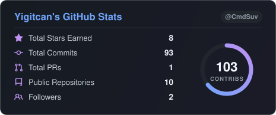
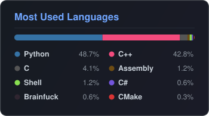
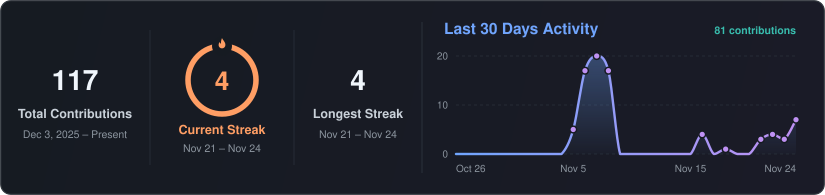

## Hi, I'm Omar Yiğitcan Mengü

I'm an **Anti-Cheat Developer & Kernel-Level Engineer** focused on low-level engineering, operating system internals, and digital forensics. I work close to the metal—analyzing how systems and binaries behave under the hood, building protection and detection mechanisms, and contributing upstream to the **Linux Kernel (`kernel.org`)**.

---

### Core Areas

- **Anti-Cheat Engineering:** Designing runtime integrity checks, detection logic, memory protection strategies, and analyzing bypass techniques across user-mode and kernel-mode boundaries.
- **Kernel-Level Development:** Working with OS internals, kernel-mode architecture, memory management, syscall paths, and low-level system debugging.
- **Low-Level Engineering & Forensics:** Memory forensics, binary analysis, execution tracing, artifact investigation, and instruction-level system analysis.
- **Open-Source Contributions:** Upstream contributor to the **Linux Kernel** (`kernel.org`).

---

### Languages & Technologies

- **C++** — Systems programming, kernel/user-mode components, performance-critical engineering
- **x86-64 Assembly** — Low-level analysis, instruction-level debugging, reverse engineering & internals
- **Python** — Forensics tooling, automation, analysis scripts, and rapid prototyping
- **Java** — Application development, tooling, and JVM-based systems

---

### What I Focus On

- Analyzing low-level attack surfaces, hooking techniques, and evasion methods
- Building memory inspection, runtime analysis, and forensic utilities
- Writing hardware-aware, performance-critical systems code
- Exploring OS internals and contributing to the Linux kernel

---

<h3>GitHub Stats</h3>

  <picture>
    <source media="(prefers-color-scheme: dark)" srcset="./assets/stats-dark.svg" />
    <source media="(prefers-color-scheme: light)" srcset="./assets/stats-light.svg" />
    
  </picture>
  &nbsp;
  <picture>
    <source media="(prefers-color-scheme: dark)" srcset="./assets/langs-dark.svg" />
    <source media="(prefers-color-scheme: light)" srcset="./assets/langs-light.svg" />
    
  </picture>

  <picture>
    <source media="(prefers-color-scheme: dark)" srcset="./assets/streak-dark.svg" />
    <source media="(prefers-color-scheme: light)" srcset="./assets/streak-light.svg" />
    
  </picture>

